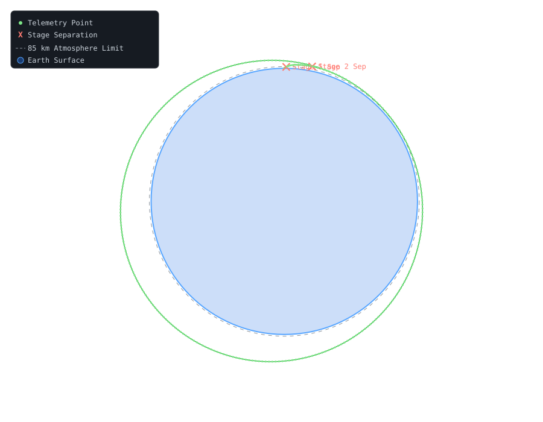

# Saturn V / Apollo 11 — Low Earth Orbit (LEO) Example

This directory contains a complete launch and orbital insertion simulation run modeled after the **Saturn V** launch vehicle achieving a stable Low Earth Orbit.

## Included Files

* **Trajectory Plot:** [`Saturn_V_trajectory.svg`](Saturn_V_trajectory.svg) — Full ascent and 360° orbital revolution showing stage separation events and the 85 km atmospheric boundary.
* **Telemetry Log:** [`Saturn_V_fl_data.txt`](Saturn_V_fl_data.txt) — Complete time-stepped flight data (`Time`, `Velocity`, `Altitude`, `Mass`, `Air Density`, `X/Y Coordinates`, and `Earth Arc`).

---

## Spacecraft Configuration

* **Number of Stages:** `3`
* **Simulation Time Step (`del_t`):** `1.0` s

| Parameter | Stage 1 (S-IC) | Stage 2 (S-II + Interstage) | Stage 3 (S-IVB + IU + Apollo CSM/LM) |
| :--- | :---: | :---: | :---: |
| **Dry Mass (`m_dry`)** | `131000` kg | `40100` kg | `59000` kg |
| **Fuel Mass (`m_fuel`)** | `2150000` kg | `444000` kg | `107000` kg |
| **Burn Time (`t_burn`)** | `162` s | `360` s | `445` s |
| **Max Thrust (`thr`)** | `34500000` N | `5115000` N | `1023000` N |
| **Drag Coefficient (`C_d`)** | `0.35` | `0.30` | `0.25` |
| **Cross Section (`crs_sct`)** | `81` $\text{m}^2$ | `80` $\text{m}^2$ | `34` $\text{m}^2$ |

---

## Guidance Commands

| Stage | Cmd | Duration (s) | Throttle (`0.0–1.0`) | Angle (deg) | Decouple / Finish |
| :--- | :---: | :---: | :---: | :---: | :---: |
| **Stage 1** | 1 | `15` | `1.0` | `90` | `N` |
| **Stage 1** | 2 | `35` | `1.0` | `78` | `N` |
| **Stage 1** | 3 | `50` | `1.0` | `62` | `N` |
| **Stage 1** | 4 | `35` | `1.0` | `48` | `N` |
| **Stage 1** | 5 | `33` | `0.8` | `38` | `Y` |
| **Stage 2** | 1 | `120` | `1.0` | `34` | `N` |
| **Stage 2** | 2 | `120` | `1.0` | `24` | `N` |
| **Stage 2** | 3 | `120` | `0.9` | `14` | `Y` |
| **Stage 3** | 1 | `150` | `1.0` | `6` | `N` |
| **Stage 3** | 2 | `135` | `1.0` | `2` | `Y` |
