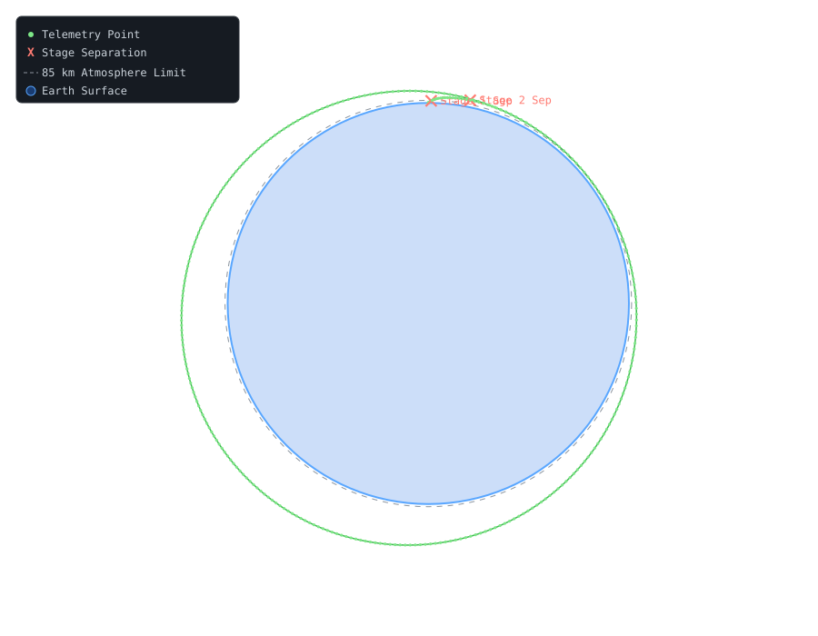

# 2D Multi-Stage Rocket & Orbital Launch Simulator

A physics-based 2D launch vehicle simulator written in C++ that models multi-stage rocket ascent, US Standard Atmosphere aerodynamics, variable mass depletion, curved-Earth orbital mechanics, and zero-dependency vector trajectory plotting.



---

## Key Features

* **Curved-Earth 2D Orbital Mechanics:** Integrates vehicle motion in Earth-centered Cartesian coordinates (`X Pos`, `Y Pos`) alongside downrange angular displacement (`Earth Arc`).
* **Local-Horizon Pitch Guidance:** Continuously transforms user-defined pitch commands relative to the local horizon as the rocket pitches over downrange.
* **Multi-Layer Atmosphere & Mach Drag:** Models temperature, pressure, and air density across tropospheric and stratospheric layers up to `85 km`, scaling drag coefficients across subsonic, transonic, supersonic, and hypersonic regimes.
* **Analytical Orbit Determination:** Evaluates specific orbital energy ($\varepsilon$), specific angular momentum ($h$), apoapsis, periapsis, eccentricity ($e$), and orbital period to verify stable Low Earth Orbit (`periapsis > 85 km`) or escape trajectories.
* **Interactive Flight Computer with `UNDO`:** Supports step-by-step input rollback during stage and command configuration, enforcing burn-time and timestep divisibility constraints.
* **Built-In SVG Trajectory Plotter:** Automatically exports a standalone `trajectory.svg` showing Earth's surface, the `85 km` atmospheric boundary, downsampled telemetry markers, and stage separation events (`X`).

---

## Physics & Numerical Model

* **Initial State:** Launches from Earth's surface at $(X, Y) = (0.0\text{ m},\ 6,378,000.0\text{ m})$ with zero initial velocity.
* **Thrust Vectoring:** Pitch commands (`angle` in degrees, where `90°` is radially outward and `0°` is tangent to the local horizon) are rotated into global Cartesian coordinates using the vehicle's downrange Earth arc (`arc`):
  ```cpp
  double thr_dir_x = cos(radian - arc);
  double thr_dir_y = sin(radian - arc);
  ```
* **Orbital Coast Visualization:** Once orbital insertion criteria are met, the integrator continues coasting for one full orbital period so the entire closed orbit is logged and plotted.

---

## Getting Started

### Prerequisites
* A C++ compiler: **MSVC (Visual Studio)** on Windows (uses `fopen_s` / `scanf_s`), or `g++` / `clang++` with `-D_CRT_SECURE_NO_WARNINGS` / standard C I/O.

### Build & Run
```bash
git clone [https://github.com/Hiz111/2D-Orbital-Launch-Simulator.git](https://github.com/Hiz111/2D-Orbital-Launch-Simulator.git)
cd 2D-Orbital-Launch-Simulator
cl /O2 /EHsc 2D-launch-sim.cpp /Fe:rocket_sim.exe
rocket_sim.exe
```

---

## Featured Example: Saturn V / Apollo 11

A complete 3-stage **Saturn V** launch and Low Earth Orbit insertion profile is available in the [`Example/`](Example/) directory:

* **Full Setup & Flight Plan:** [`Example/README.md`](Example/README.md)
* **Trajectory Plot:** [`Example/Saturn_V_trajectory.svg`](Example/Saturn_V_trajectory.svg)
* **Telemetry Log:** [`Example/Saturn_V_fl_data.txt`](Example/Saturn_V_fl_data.txt)

---

## Telemetry Output

Each simulation run generates a tab-separated `fl_data.txt` log and `trajectory.svg` graphic:

| Column | Description |
| :--- | :--- |
| `Time (s)` | Elapsed mission time since liftoff |
| `Velocity (ms-1)` | Total inertial speed |
| `Altitude (m)` | Height above Earth's surface ($R_\oplus = 6,378,000\text{ m}$) |
| `Mass (kg)` | Current total vehicle mass |
| `Air Density (kgm-3)` | Local atmospheric density |
| `X Pos` / `Y Pos` | Earth-centered 2D Cartesian coordinates ($\text{m}$) |
| `Earth Arc (rad)` | Downrange angular distance traveled around Earth |

---

## License

Distributed under the MIT License. See [`LICENSE`](LICENSE) for details.
